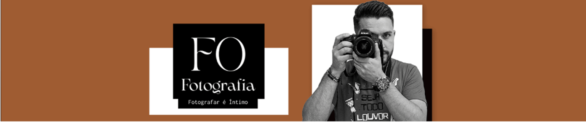
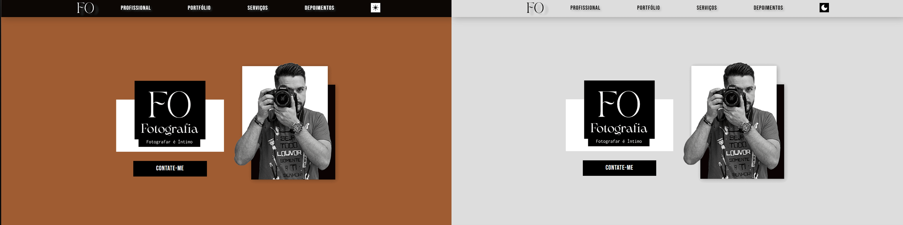
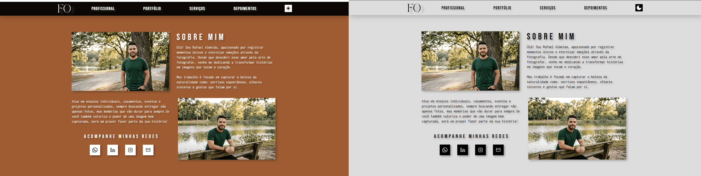
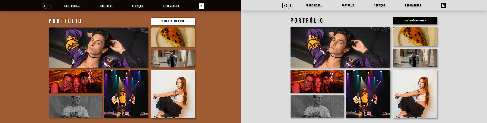
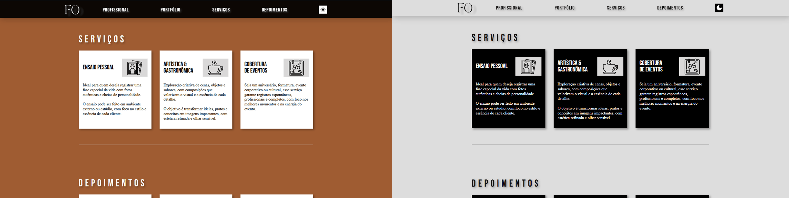
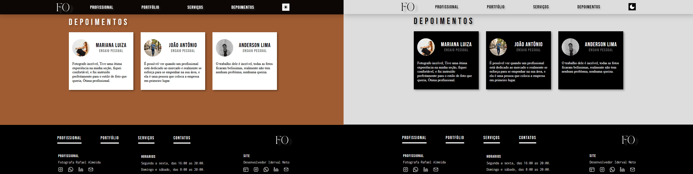
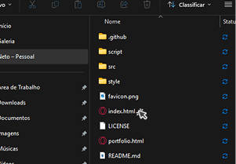
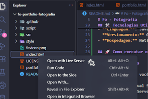
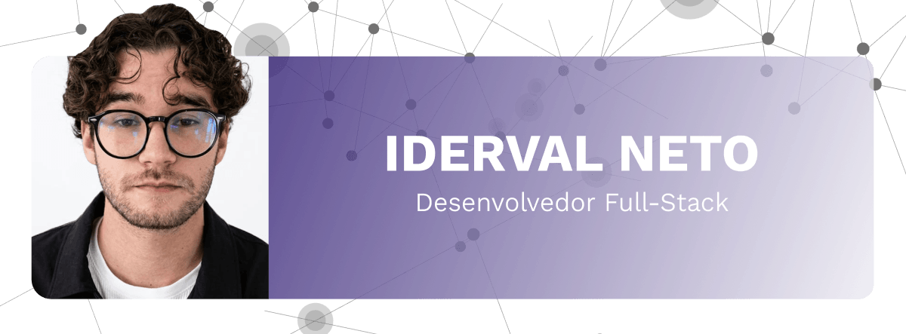

# Fo - Fotografia



> Site de portfólio responsivo para fotógrafos, incluindo seções de galeria, sobre, serviços e depoimentos de clientes. Feito com Html Css e JavaScript.

[](LICENSE)

## 💻 Sobre o projeto

Site de portfólio responsivo para fotógrafos, incluindo seções de galeria, informações profissionais, serviços e depoimentos de clientes. Feito com Html Css e JavaScript. Feito para centralização de informações profisisonais, onde contem trabalhos anteriores categorizados, informações sobre o profissional para conectividade com cliente, tipos de serviços que faz, e depoimentos de clientes antigos.

🌐 <strong>Acesse o site:</strong> <a href="https://fo-fotografia.netlify.app" target="_blank" rel="noopener noreferrer">https://fo-fotografia.netlify.app</a>

### Seção Home:



### Seção Profissional:



### Seção de Portfolio:\*\*



### Seção de Serviços:



### Seção de Depoimentos:



## ⚙️ Funcionalidades

- Alternador de Tema.
- Filtragem Categorizada de Portfolio.
- Ampliação de Foto.
- Direcionamento para redes.

## 🛠️ Tecnologias Utilizadas

**Linguagens:**


**Versionamento:**


**Hospedagem:**


## 🚀 Como executar o projeto

### Pré-requisitos

Antes de começar, você vai precisar ter instalado em sua máquina:

- Ferramenta: Visual Studio Code
- Extenção: Live Server

### Passo a passo

1.  **Clone o repositório:**
    ```bash
    git clone https://github.com/N3TO0/fo-portfolio-fotografia.git
    ```
2.  **Entre na pasta:**
    ```bash
    cd fo-portfolio-fotografia
    ```
3.  **Execute a aplicação:**

    ```bash
    Abra o arquivo index.html:
    ```

    

    <br>

    ```bash
    Em caso de usar visual studio code, utilize o Live Server:
    ```

    

## 📁 Estrutura de Pastas

```bash
fo-portfolio-fotografia/
├── .github/
│   └── assets/             <-- Imagens do README.md
├── script/                 <-- Arquivos JS contendo funcionalidades.
├── src/
│   ├── icon/               <-- Icones do site
│   └── img/                <-- Imagens do site
│       └── portfolio/      <-- Imagens do portfolio separada por categoria
│── style/                  <-- arquivos css com estilizações
├── index.html              <-- arquivo html principal e inicial
├── LICENSE                 <-- Licença do projeto
├── portfolio.html          <-- pagina html contendo o portfolio e suas categorias
└── README.md               <-- Documentação do projeto "Onde você esta agora!"
```

Uma breve explicação da organização dos arquivos:

- `/src`: Pasta separadas contendo imagens e icones utilizado no projeto.

- `style/`: Pasta contendo arquivos css componentizados por seção, home, footer e arquivo<br>css global para alteração de cores e fontes.

- `script/`: Pasta contendo arquivos js cada arquivo com funcionalidade diferente,<br> funcionalidade de troca de tema, acionamento do menu mobile e filtragem de portfolio.

- `/.github`: Pasta contendo imagens utilizadas no arquivo de documentação do projeto<br>Readme.md

## ✍️ Autor

<br>

[](https://iderval-neto-dev.netlify.app)
[](https://wa.me/5588981621337?text=Olá!%20Vim%20pelo%20seu%20github.)
<a href="https://www.instagram.com/n3to_00/" target="_blank"></a>
<a href="https://www.linkedin.com/in/iderval-neto/" target="_blank"></a>
<a href="mailto:neto.dev.12@gmail.com" target="_blank"></a>

---

## 📄 Licença

Este projeto está sob a licença **MIT**. Para mais detalhes, consulte o arquivo [LICENSE](LICENSE).
